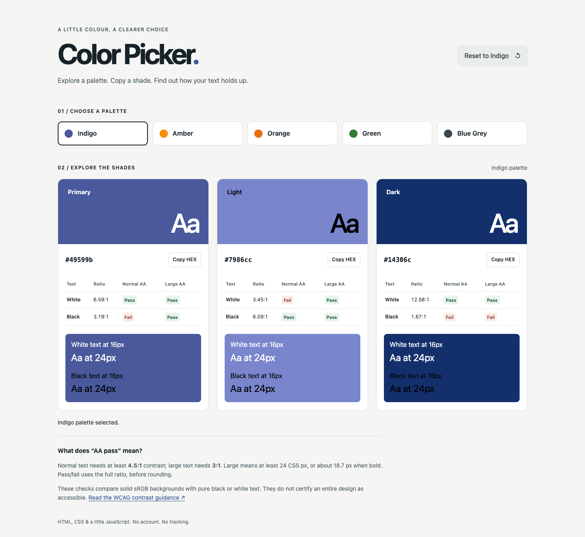

# Color Picker

A small, framework-free palette explorer: compare primary, light and dark shades, copy HEX values, and check black or white text against WCAG AA contrast thresholds.



## Features

- Five curated palettes: Indigo, Amber, Orange, Green and Blue Grey.
- Three shades per palette, each with a selectable HEX value and copy button.
- Calculated contrast ratios for pure white and black text.
- Separate AA pass/fail results for normal and large text, with real text samples.
- Keyboard-operable palette buttons, visible focus states and copy-status announcements.
- Responsive layout with no runtime dependencies, remote fonts, analytics or account requirement.

## Run locally

From the repository folder:

```sh
python3 -m http.server 8080 --bind 127.0.0.1
```

Open [http://127.0.0.1:8080](http://127.0.0.1:8080). The address means your own computer. No package installation or build step is needed to use the app. Stop the server with `Ctrl+C`.

Use a local HTTP server rather than opening `index.html` directly: browsers restrict JavaScript module loading from `file://` URLs. Any static server that serves JavaScript with the correct MIME type will work.

## Use it

1. Choose a palette. Indigo is selected initially.
2. Compare its Primary, Light and Dark cards.
3. Inspect each contrast ratio and its normal/large-text AA results.
4. Choose **Copy HEX** to copy only the six-digit colour value, including `#`.
5. Choose **Reset to Indigo** to restore the initial selection.

Clipboard writing depends on browser permissions and a secure context (HTTPS or a trusted local origin). If copying fails, the app selects the HEX field and explains how to copy it manually. It does not claim success before the clipboard operation completes.

## How contrast is calculated

`color.js` converts six-digit HEX values from sRGB to linear-light components, computes relative luminance, and compares foreground and background luminance. The full contrast ratio determines pass/fail; the displayed ratio is rounded to two decimal places.

| WCAG AA text category | Minimum ratio |
| --- | --- |
| Normal text | 4.5:1 |
| Large text | 3:1 |

Large text means at least 24 CSS px, or approximately 18.7 CSS px when bold. The samples use 16 px normal text and 24 px large text. The coloured header uses whichever of black or white provides greater contrast; the lower samples intentionally show both, including failing combinations.

References: [W3C contrast guidance](https://www.w3.org/WAI/WCAG22/Understanding/contrast-minimum.html) and [MDN Clipboard API](https://developer.mozilla.org/en-US/docs/Web/API/Clipboard/writeText).

### Limitations

This is a contrast explorer, not a full accessibility audit or certification. It does not evaluate gradients, transparency, images, font rendering, focus visibility in another design, or WCAG AAA. Only the five supplied palettes are supported; there is no arbitrary-colour input or automatic shade generation. Passing the ratio threshold does not establish the accessibility of a complete page.

## Project structure

```text
index.html                 Semantic page structure
style.css                  Responsive layout and focus styles
app.js                     Palette selection, cards and clipboard feedback
color.js                   Palette data and pure contrast functions
tests/color.test.js        Calculation, validation and threshold tests
scripts/browser-check.cjs  Chrome interaction and accessibility smoke checks
docs/preview.png           Screenshot of the implemented interface
.github/workflows/ci.yml   JavaScript syntax and unit-test checks
```

`app.js` uses event listeners and DOM creation rather than inline handlers or a separate branch per palette. Colour data lives in one place, so navigation swatches and result cards stay consistent.

## Development checks

Node.js 22.12+ is needed for the development tools, not for running the website.

```sh
npm ci
npm run check
npm test
```

Unit tests cover known luminance/contrast values, symmetry, invalid inputs, strict unrounded AA thresholds and every palette's header foreground choice. GitHub Actions runs syntax and unit checks on Node 22 and 24. The workflow is supplied; remote CI success must be checked after publication.

### Browser smoke check

With Google Chrome installed and the local server running:

```sh
npm run test:browser
```

For another local port:

```sh
COLOR_PICKER_URL=http://127.0.0.1:8091 npm run test:browser
```

The script uses Playwright and axe-core as development-only dependencies. It verifies all palette selections, reset, Enter-key activation, simulated clipboard success/permission denial, and horizontal overflow at 375, 820, 840, 1024 and 1440 px viewports. The automated accessibility scan excludes `.text-samples` because those deliberately demonstrate insufficient contrast; all other regions are scanned. This is a smoke check, not a manual screen-reader audit or a full accessibility claim. Clipboard branches are mocked so checks do not replace your system clipboard.

Refresh the README screenshot with the server running:

```sh
UPDATE_PREVIEW=1 npm run test:browser
```

## Publish as a static site

Serve these files from a static host that supports JavaScript modules. GitHub Pages can serve the repository root; it requires no compilation. Enable it through the repository settings when you are ready. This repository does not automatically publish a site.

## Development history and AI assistance

The existing project began as a plain HTML/CSS/JavaScript palette experiment. This revision was developed with OpenAI Codex assistance: replacing hard-coded legibility labels with calculated contrast, consolidating repeated logic, improving the controls, and adding tests and documentation. Existing Git history is preserved. The original project should not be described as AI-generated retroactively.

## License

No project license has been selected in this repository. Public source availability does not itself grant a reuse license; the repository owner should choose one before inviting redistribution. Development dependencies retain their own licenses.
